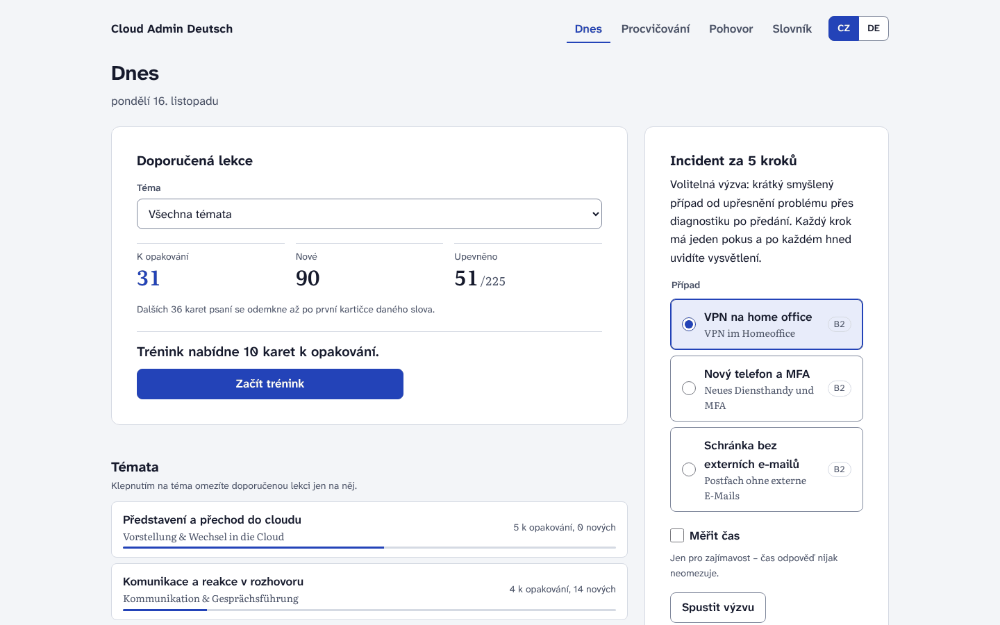
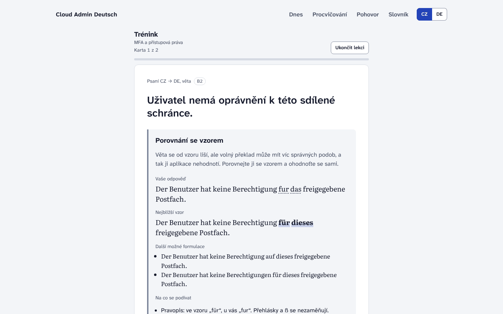
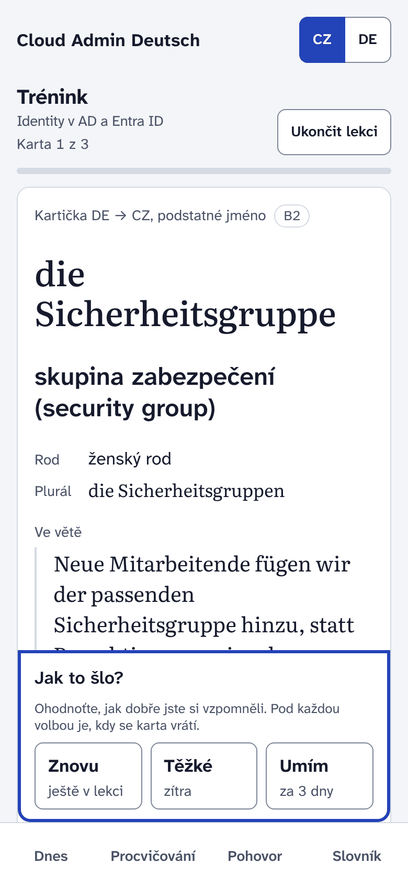
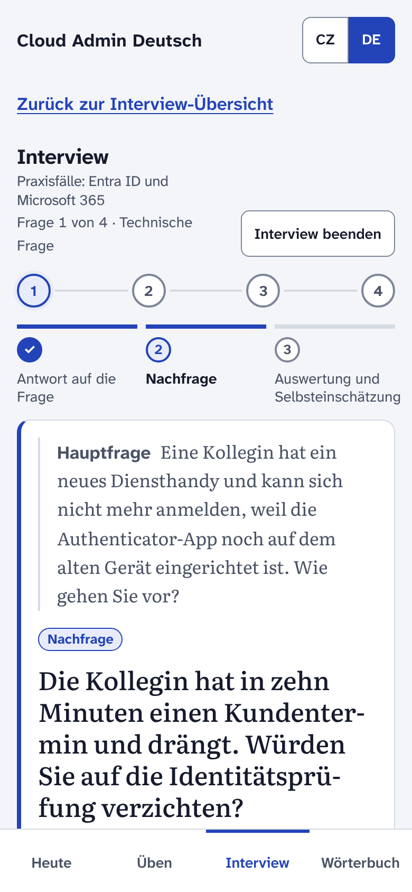

# Cloud Admin Deutsch (AT)

A static web app for practising German for IT administrator job interviews in Austria: Cloud, Azure, Microsoft 365 and IT System Administrator roles at level B2–C1. It is built for Czech speakers. The study content is Austrian standard German with Czech explanations; the interface is Czech by default and can be switched to German. There is no backend and no account: progress stays in your browser.

**Live demo:** [brutusfilip.github.io/cloud-admin-deutsch-at](https://brutusfilip.github.io/cloud-admin-deutsch-at/). It starts empty, and your progress stays in your browser.

<p>
  
  
</p>
<p>
  
  
</p>

*Screenshots of the production build with illustrative, fictional progress. Desktop 1440 × 900: Today, and a written answer compared with the model. Phone 390 × 844: a revealed flashcard, and the interview with the German interface.*

## What it does

- **Short lessons with spaced repetition.** Up to 10 cards in four modes: flashcards DE → CZ, listening DE → CZ, writing CZ → DE and grammar tasks (gap, choice, word order, transformation). Cards come back after 3, 7, 14, 30 and 60 days. No streaks, quotas or deadlines.
- **Feedback that explains.** Wrong answers name the mistake: article and gender, missing umlaut or ß, capital letter, word order. A missing comma is a note with the exact place, not a mistake.
- **Interview practice.** 4 short interviews with 14 questions. You answer aloud, get a follow-up question, then see an illustrative model answer with facts to replace by your own, useful phrases, dictionary links and a self-assessment checklist. Questions can be read aloud on request (Web Speech API).
- **Incident in 5 steps.** An optional fictional support case from clarifying the problem to the hand-over, with an explanation after each step.
- **Dictionary.** 150 entries with search in German and Czech that ignores diacritics, filters shown as removable chips, forms, examples and Austrian notes.
- **Progress you control.** Export and import as a JSON file, a reset with its own confirmation, statistics, and a clear message when the browser refuses to save.
- **Accessible on desktop and phone.** Keyboard operation, visible focus, modal dialogs that keep and return the focus, `lang` on every German part, reduced motion, layouts checked from 320 to 1440 px.

## Automatic checking and self-assessment

| Exercise | Who decides | How |
|---|---|---|
| Writing a word or phrase CZ → DE, grammar tasks, the 5-step challenge | the app | Only the predefined answer and its listed variants count. Umlauts, ß, articles, cases and capital letters are graded. Punctuation differences are shown as a note, not counted as a mistake. |
| Writing a whole sentence (free translation) | the app if it matches the model or a listed formulation, otherwise you | Any other difference is shown neutrally next to the closest model, and you rate yourself (Znovu / Těžké / Umím). A correct alternative never ends with a misleading "wrong". |
| Flashcards and listening DE → CZ | you | Reveal the solution and rate how well you remembered it. |
| Interview answers | you | Spoken answers are not recorded or scored. You rate four criteria: direct answer, structure, vocabulary, follow-up. |

Statistics keep these apart: first-attempt accuracy checked by the app, your own ratings, completed lessons and interview self-assessments.

Real results from the app (they are also checked by the tests):
- Writing *der Authentifizierungsmethode* for "metoda ověřování" gives **Chyba** with "Člen: správně „die“ (ženský rod), ne „der“." (the article is wrong, the hint names the gender).
- *Ich konnte ab Janner beginnen* gives **Chyba** with the missing *ö* and *ä* named.
- *Meinen Sie damit die Berechtigungen in Entra ID oder eher die Freigaben auf dem Dateiserver?* is not a listed formulation. It gives **Porovnání se vzorem** (comparison with the model), marks *eher* as a difference and offers three self-ratings.

## Tech stack

- React 19.3, TypeScript 7.0, Vite 8.3 (Rolldown), plain CSS with design tokens
- Vitest 5.1 for unit, integration and content tests; Playwright 1.63 for browser tests; oxlint 1.91
- Self-hosted fonts: Literata for German, Atkinson Hyperlegible Next for the interface
- Browser APIs: `localStorage`, Web Locks, Web Speech API (optional), `<dialog>`
- No backend and no runtime dependencies besides React and the two fonts
- GitHub Actions for checks, GitHub Pages for hosting

## Quick start

You need **Node.js 26 LTS** (the version in `.nvmrc`, also used by CI) and npm. Node 22.12+ and 24 work as well. Older versions are refused at install time (`engines` in `package.json` and `engine-strict` in `.npmrc`).

```bash
git clone https://github.com/BrutusFilip/cloud-admin-deutsch-at.git
cd cloud-admin-deutsch-at
npm ci               # installs exactly the versions in package-lock.json
npm run dev          # development server: http://localhost:5173/
```

Production build and preview:

```bash
npm run build        # type check and build into dist/
npm run preview      # serves dist/: http://localhost:4173/
```

On Windows with PowerShell, step by step and with fixes for common problems (in Czech): [docs/QUICKSTART_CS.md](docs/QUICKSTART_CS.md).

## Checks

| Script | What it does | Result on 2026-11-16 |
|---|---|---|
| `npm run lint` | oxlint | no findings |
| `npm run typecheck` | TypeScript (`tsc -b`: app, config, browser tests) | no errors |
| `npm test` | all unit, integration and content tests (Vitest) | 237 passed, 1 skipped |
| `npm run build` | type check and production build into `dist/` | about 193 kB of JS and CSS (gzip) |
| `npm run check` | lint, typecheck, test and build in one go | exit code 0 |
| `npm run test:e2e` | build, then browser tests of the build under the GitHub Pages subpath (Playwright, Chromium on a desktop and a phone); first time: `npx playwright install chromium` | 23 passed |
| `npm run check:content` | study data: IDs, required fields, answers, interviews, privacy rules | 22 passed, 1 skipped |
| `npm run test:answers` | answer checking and grammar tasks | 46 passed |
| `npm run test:scheduler` | scheduler, lessons, Today counts, local calendar days | 47 passed |
| `npm run test:reload` | recovery after a reload, storage, write revisions, one writing tab | 44 passed |
| `npm run test:stats` | statistics, challenge result, interview hints | 20 passed |
| `npm run test:import` | export, rejected imports, export → import round trip | 11 passed |
| `npm run stats:content` | real content counts as Markdown tables | – |

The browser tests aim at what could lose progress or block studying: a first lesson and its due dates after a reload, a lesson resumed before and after an answer, repeated clicks, the kinds of written answers, dictionary filters and the link from the interview, a whole interview and the 5-step challenge, the timer and read-aloud stopped on leaving, export and import into a new browser profile, invalid and older files, reset, failed writes, switching CZ/DE, two open tabs, the keyboard, a dialog, reduced motion and a phone layout. Every test fails on a console error, an HTTP error or a request to another host. Other browsers: `E2E_BROWSERS=chrome,firefox,webkit npm run test:e2e` after `npx playwright install firefox webkit`.

## Supported environments

Only what was actually checked (2026-11-16 and 2026-11-17):

| Area | Checked | Not checked yet |
|---|---|---|
| Node.js and npm | Clean `npm ci` and `npm run check` on Linux with Node 26.13.0, 24.22.2 and 22.23.4 (npm 10.9.9), and with npm 11.21.2 on Node 24 and 26. Node 20 is refused with `EBADENGINE`. GitHub Actions: Node 26.13.1. | – |
| Operating systems | Linux: install, checks, build, browser tests, also on GitHub Actions (`ubuntu-latest`). Windows x64 and macOS arm64: the lockfile resolves their native packages. Windows: the live site in a Chromium 156 based browser. | A real install on Windows and macOS |
| Browsers | Chromium 153 and Google Chrome for Testing 153, on a desktop and on emulated phones (320 to 412 px wide). On GitHub Actions all browser tests also pass in Firefox 155 and in WebKit 26.6 (Safari's engine), on a desktop and an emulated iPhone 13. The live site: a short pass in a Chromium 156 based browser on Windows, on a desktop and an emulated phone. | Safari on macOS and iOS, Edge, real phones, screen readers, real speech voices |

## How data flows

```text
src/content   study data (TypeScript modules), validated by tests, bundled at build time
     ↓
src/domain    pure functions: answer checking, grammar, scheduler, lessons, interviews, search
     ↓
src/storage   progress schema 5: validation, migrations, export and import (JSON)
     ↓
src/state     React context: saves every change to localStorage, one writing tab, write revisions
     ↓
src/features  screens: Today, lesson, practice, interview, dictionary, settings
```

A screen calls a domain function with the current progress. The progress context saves the result to `localStorage` at once, but only over the revision this tab last saw. Every screen then shows that state. Stored data is validated whenever it is loaded or imported. The interface language changes only the interface texts (`src/i18n`); German questions, Czech translations and CZ → DE tasks are learning content and stay as they are.

## Local storage and privacy

- **Where progress lives.** Only in this browser, under keys that start with `cloud-admin-deutsch-at:`. `…:progress` holds the progress (`schemaVersion: 5`), validated against a whitelist on every load. Data of an older version is converted only after it passes the checks, and the original text is kept under `…:backup` before the first write. Data written by a newer version of the app is never overwritten.
- **Nothing leaves the browser.** No accounts, no backend, no analytics, no external requests. Fonts are part of the build.
- **What a reload keeps.** A checked answer is saved at once: after a reload you see the same result and only the rating is left. Typed text that has not been checked yet is not kept. Every rating counts once.
- **One tab saves at a time** (Web Locks API). Other tabs show the saved state read-only until you choose "Pracovat v této kartě" ("Work in this tab"). Every write also checks a revision number, so an outdated tab saves nothing.
- **One browser, one address.** Progress belongs to one browser profile and one address: `localhost:5173` (dev), `localhost:4173` (preview) and the published site each have their own. Move progress with **Nastavení → Stáhnout export** and import it at the other address.
- **Shared origin on GitHub Pages.** All Pages sites of one account share the origin `https://<account>.github.io`, so they can read each other's storage. Own interview examples should therefore contain no names of companies, clients or colleagues; the app says so where you write them.
- **Import** checks the format, versions, every value and the size (2 MB at most) first. An invalid file changes nothing; a valid one shows a summary and replaces progress only after confirmation. Exports of version 1.0 are converted.
- **Reset** has its own confirmation dialog and removes exactly the app's keys.
- **When saving fails**, the message offers an export of the current state, and the stored data stays as it was.
- **Exports are private.** They contain your own examples: `cloud-admin-deutsch-progress-*.json` is in `.gitignore`. Study content uses fictional data only.

## Extending the study set

Lessons are composed automatically from the items of a topic, so new material is added as content:

1. Add items at the end of `src/content/items/<topic>.ts` with the next free ID: `<topic>-v-NNN` for words and phrases, `-s-` for sentences, `-g-` for grammar tasks. For a new topic, add it to `src/content/topics.ts`, create its items file and include it in `ITEMS` in `src/content/index.ts`.
2. Add every new ID to `src/content/releasedIds.ts`. Released IDs never change, because progress is stored per ID.
3. Interview questions go to `src/content/interviews.ts`, challenge cases to `src/content/challenges.ts`.
4. Run `npm run check:content`, then `npm run stats:content`.

The content rules, in Czech, are in [docs/CONTENT_GUIDE.md](docs/CONTENT_GUIDE.md). An optional local deny-list (`content-denylist.local.txt`, ignored by git) lets the content check reject real names.

## Deployment to GitHub Pages

Two workflows are included. Both use Node.js from `.nvmrc` and install with `npm ci` from `package-lock.json`.

- **`.github/workflows/ci.yml`** runs on every pull request and every push to `main`: `npm run lint`, `npm run typecheck`, `npm test`, `npm run build` and `npm run test:e2e` (Chromium). Firefox and WebKit run there too: all their tests passed on 2026-11-17, and their results are reported without failing the workflow. CI never deploys.
- **`.github/workflows/deploy.yml`** is started by hand from the publication branch `main` (`PUBLISH_BRANCH` in the file). It runs the same checks, builds, tests the build in Chromium and uploads exactly that build. A second job deploys it in the `github-pages` environment with `pages: write` and `id-token: write`. Only one deployment runs at a time, and a running one is never cancelled.

To publish:

1. Push the repository to GitHub with the default branch `main`.
2. **Settings → Pages → Build and deployment → Source: GitHub Actions.**
3. **Actions → Deploy to GitHub Pages → Run workflow** on `main`.
4. The site is at `https://<account>.github.io/<repository>/`.

The live demo above was deployed this way from `main` on 2026-11-17.

**Base path and routing.** Nothing to configure. The build uses relative asset paths (`base: './'` in `vite.config.ts`) and routes live in the URL hash (`#/slovnik/…`). So the site works under any repository name, at a domain root and on any static server. A reload of any view requests only `index.html`, and no 404 fallback is needed. The build was checked under `/cloud-admin-deutsch-at/`, under another repository name and at a domain root, with every view opened directly and reloaded. Only a switch to path-based routes would need an absolute `base` in `vite.config.ts` and a `404.html` fallback.

**Another branch or a subfolder.** For another publication branch, change `main` in both workflows and allow the branch in **Settings → Environments → github-pages**. If the app lives in a subfolder of a repository, set `APP_DIR` in both workflows and keep the workflow files in the repository's `.github/workflows/`. Opening `dist/index.html` straight from disk does not work, because browsers block module scripts there; the page then says how to start the app.

## Project structure

```text
src/
  content/    study data: topics, items, challenge cases, interviews
  domain/     pure logic: answer checking, grammar, scheduler, lessons, interviews, search, content validation
  storage/    versioned browser storage, migrations, whitelist validation, export and import
  state/      React context: progress, persistence, storage status, tab lock
  features/   screens: today, lesson, practice, interview, dictionary, settings
  components/ shared parts: confirmation dialog, storage messages, level chip, Czech text with marked German quotes
  i18n/       interface texts: Czech (default) and German
  lib/        formatting, downloads, read-aloud, fitting long German words, keeping answers and results in view
  styles/     design tokens and CSS
e2e/          Playwright tests of the production build (fictional data only)
docs/         Czech guide and quick start, release checklist, plan, content rules, screenshots
```

## Documentation

- [docs/QUICKSTART_CS.md](docs/QUICKSTART_CS.md): running it on Windows with PowerShell, moving progress, fixing common problems, publishing (Czech)
- [docs/README.cs.md](docs/README.cs.md): user guide (Czech)
- [docs/RELEASE_CHECKLIST.md](docs/RELEASE_CHECKLIST.md): requirements, checks with environment and results, defects by impact (Czech)
- [PROJECT_STATE.md](PROJECT_STATE.md): current state, decisions, open points (Czech)
- [docs/PLAN.md](docs/PLAN.md) and [docs/CONTENT_GUIDE.md](docs/CONTENT_GUIDE.md): plan and content rules (Czech)

## License

No license has been chosen yet, so all rights are reserved for now.
