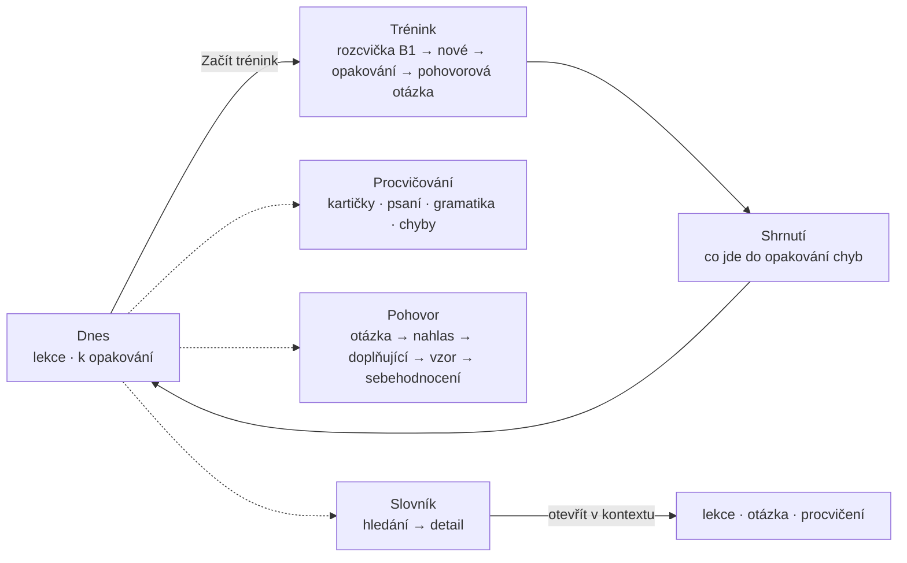

# Cloud Admin Deutsch (AT) — realizační plán

Součást projektu **Cloud Admin Journey in Austria**. Statická webová aplikace pro trénink pohotových, přesných a přirozených odpovědí na úrovni B2–C1 na pohovorech v Rakousku: Cloud Administrator, Azure Administrator, Microsoft 365 Administrator a IT System Administrator.

Stav: **verze 1.0 – portfolio** (2026-11-11): export, import a smazání pokroku (E7.1, E7.2, E7.4 část), německé rozhraní, příprava publikace (E10), workflow pro pull requesty a ruční nasazení; dříve E1–E5 kromě E4.4 a E5.6 · obsah po etapě 8: 150 položek ve 13 tématech, 34 gramatických úloh, 3 výzvy, 4 pohovory · aktuální stav, rozhodnutí a otevřené body: [`PROJECT_STATE.md`](../PROJECT_STATE.md)

**Etapa 6 (audit, 2026-11-11):** stav požadavků proti tomuto plánu, závady P0–P2 a jejich rozdělení do etap 7–11 jsou v [`RELEASE_CHECKLIST.md`](RELEASE_CHECKLIST.md). **Etapa 7 (2026-11-11)** upravila kap. 7 a 8 (tah lekce, schéma 5, jedna zapisující karta, zachování původních dat, statistiky). Body E0–E10 níže jsou body plánu, ne etapy promptů. Kap. 4 u Pohovoru ještě popisuje původní návrh z E0, který zadání E5 nahradilo (D41, D44, D45 v `PROJECT_STATE.md`); úprava je naplánovaná jako Z14. **Etapa 8 (2026-11-12)** podle vašeho zadání dokončila výukový obsah a zpětnou vazbu: redakční kontrola všech položek, 15 nových položek, volný překlad s porovnáním se vzorem, interpunkce jako kosmetická odchylka, důvody u chybných možností, režim Poslech a orientační úroveň (D78–D87 v `PROJECT_STATE.md`). Pravidla obsahu jsou v [`CONTENT_GUIDE.md`](CONTENT_GUIDE.md). Rozšíření obsahu o další desítky položek (cílový rozsah kap. 5) se podle téhož zadání přesouvá až za dokončení této verze.

Kapitoly 6–8 popisují model, plánovač a ukládání tak, jak jsou implementované (E1, rozšířeno v E4 a E5). Cílový model z E0 pro export zůstává v kap. 6.2; pohovor je od E5 implementovaný podle kap. 6.1.

## 1. Zásady

- **Hotovo = splněné kritérium.** Položka postoupí jen po vlastním pokusu a hodnocení. Samotné zobrazení řešení se počítá jako „Znovu“.
- **Bez streaků, denních kvót, kalendáře a termínů.** „Dnes“ znamená „co má smysl teď“. Pauza nic nenuluje.
- **Čeština až po odpovědi nebo na vyžádání.** Otázky jsou převážně v *Sie*.
- **Vše lokálně.** Bez registrace, backendu, placených API a telemetrie.
- **Veřejné repo obsahuje jen fiktivní data.** Vlastní příklady zůstávají v prohlížeči a v exportním souboru.

## 2. Umístění projektu

| Co | Kde |
|---|---|
| Repo | samostatná složka a samostatný Git repozitář `cloud-admin-deutsch-at/` (kořen složky = kořen repa) |
| Vazba na Cloud Admin Journey | samostatné repo, na které odkazuje hlavní projekt; nevnořovat do jiného Git repa |
| Vývoj v tomto chatu | můj cloudový pracovní prostor `/home/claude/cloud-admin-deutsch-at/`; po každé etapě předám zip celé složky |
| Publikace | GitHub Pages (project site) `https://<účet>.github.io/cloud-admin-deutsch-at/`; díky `base: './'` a hash routování funguje i pod jiným názvem repa |

## 3. Čtyři části aplikace

| Část | Adresa | Obsah | Hlavní akce |
|---|---|---|---|
| **Dnes** | `#/` | počet karet k opakování a nových, výběr tématu, rozpracovaná lekce, volitelná výzva „Incident za 5 kroků“, přehled témat; později cíl lekce a délka tréninku (E4.4, E7) | **Začít trénink** |
| **Procvičování** | `#/procvicovani` | kartičky DE → CZ s odkrytím, psaná odpověď CZ → DE, gramatické úlohy (filtr podle jevu), rychlé opakování chyb; filtry téma / úroveň | Začít procvičování |
| **Pohovor** (E5) | `#/pohovor` · `#/pohovor/<id>` | výběr scénáře → otázka v němčině (čeština, nápověda a předčítání na vyžádání) → odpověď nahlas s volitelným časovačem → doplňující otázka → ilustrační vzor s fakty k nahrazení, hesla ze slovníku a formulace → vlastní příklad → sebehodnocení → souhrn | Začít pohovor |
| **Slovník** | `#/slovnik?q=…&tema=…&uroven=…&druh=…` · `#/slovnik/<id>` | hledání DE/CZ bez ohledu na diakritiku, filtry téma / úroveň / druh, detail hesla s tvary, větou, poznámkami, zdroji a procvičením karet; u gramatické úlohy zadání, další řešení, vysvětlení a „Použito ve výzvě“ | Procvičit kartu |
| doplňkové | `#/lekce` · `#/nastaveni` | běh lekce a její souhrn; nastavení: jazyk rozhraní, předčítání (E5), export, import a smazání pokroku (v1.0) | — |

Navigace má 4 položky (Pohovor od E5), odkaz na Nastavení je v patičce a přepínač jazyka rozhraní CZ/DE v záhlaví (v1.0). Na mobilu je dole, na desktopu nahoře. UI je česky (texty v `src/i18n/cs.ts`, odděleně od dat), učební obsah německy (`lang="de-AT"`).

## 4. Hlavní uživatelský tok



**Trénink („Začít trénink“)** – implementováno v E1

1. Lekce má nejvýše 10 karet. Nejdřív karty na řadě (nejdéle čekající první), volná místa doplní nové karty v pořadí studijní cesty. Z jedné položky je v lekci jen jedna karta.
2. Výběr tématu omezí lekci na jedno téma. Když v tématu nic nečeká, Dnes ukáže nejbližší termín a nabídne volné procvičení nebo všechna témata.
3. „Znovu“ vrátí kartu o 3 karty později, nejvýše 3 pokusy na kartu a lekci.
4. Souhrn: první hodnocení každé karty, seznam chyb a těžkých karet, tlačítko „Zopakovat chyby“. Žádné skóre série.
5. Každé hodnocení se ukládá hned. Rozpracovanou lekci lze po reloadu dokončit ve stejný den; od dalšího dne se uzavře souhrnem.

Gramatické úlohy (E4) jsou v tréninku zamíchané v pořadí studijní cesty a mají jednu kartu `<id>:grammar`.

**Výzva „Incident za 5 kroků“** – implementováno v E4

1. Na Dnes si zvolíte smyšlený případ (VPN na home office, nový telefon a MFA, schránka bez externích e-mailů) a případně „Měřit čas“.
2. Pět navazujících kroků: upřesnění problému → rozsah nebo diagnostika → příčina nebo řešení → komunikace → předání. Situace je německy, čeština na vyžádání.
3. Kroky používají běžné karty a jejich UI. Každý krok má jeden pokus (bez vracení v lekci) a hned po něm konkrétní zpětnou vazbu s vysvětlením.
4. Výsledek ukáže přesnost prvního pokusu po krocích, volitelně čas, a nabídne „Zopakovat chyby“ a „Zkusit výzvu znovu“. Hodnocení kroků se ukládají jako u každé jiné karty.
5. Stopky nikdy neomezují odpověď a výzva funguje i s vypnutými animacemi.

Plánované doplňky: rozcvička B1 a lekce jako obsahová jednotka (E4.4), pohovorová otázka jako poslední krok (E5.6), volba délky tréninku (E7.3).

**Pohovor**

1. Doporučená otázka (čekající nebo dosud nezkoušená), případně výběr podle tématu.
2. Otázka je německy. Aplikace ji umí přečíst (`speechSynthesis`, hlas `de-AT`, záložně `de-DE`). Čeština je jen na vyžádání.
3. „Odpovídám“ spustí časovač s doporučenou délkou a odpovídáte nahlas. Volitelná nahrávka pro poslech zůstává jen v paměti.
4. Doplňující otázka a další odpověď nahlas.
5. Odkrytí: co tazatel zjišťuje, doporučená stavba odpovědi, vzorová formulace se štítkem **Ilustrační**, klíčové fráze a překlad.
6. Sebehodnocení: body rubriky a celkové hodnocení Nejistě / S obtížemi / Dobře / Jistě, z něhož plyne termín dalšího opakování.
7. Vlastní ověřitelný příklad s úrovní doložení: CV · potvrzená praxe · ověřeno v labu · odhad · zatím neověřeno. „Odhad“ a „neověřeno“ jsou označené k ověření před pohovorem.

## 5. Obsah

### Témata (pořadí = studijní cesta)

| # | `topic` | Téma | Příklad otázky (DE) |
|---|---|---|---|
| 1 | `intro` | Představení a přechod z podpory do cloudu · *Vorstellung & Wechsel in die Cloud* | „Erzählen Sie uns kurz, wie Sie vom IT-Support zur Administration gekommen sind.“ |
| 2 | `communication` | Komunikace a reakce v rozhovoru (od E4) · *Kommunikation & Gesprächsführung* | „Wie gehen Sie vor, wenn mehrere dringende Anfragen gleichzeitig eintreffen?“ |
| 3 | `identity` | Identity v AD a Microsoft Entra ID · *Identitäten: AD & Entra ID* | „Worin unterscheiden sich Active Directory und Microsoft Entra ID aus Ihrer Sicht?“ |
| 4 | `access` | MFA a přístupová práva · *MFA & Zugriffsrechte* | „Wie setzen Sie das Least-Privilege-Prinzip in der Praxis um?“ |
| 5 | `m365` | Správa Microsoft 365 · *Microsoft-365-Administration* | „Ein Postfach erhält plötzlich keine externen E-Mails mehr. Wo setzen Sie an?“ |
| 6 | `azure` | Správa Azure · *Azure-Administration* | „Wie würden Sie Berechtigungen für ein neues Projekt in Azure strukturieren?“ |
| 7 | `windows` | Windows a koncová zařízení · *Windows & Endgeräte* | „Ein Windows-Client ist seit dem letzten Update extrem langsam. Wie gehen Sie vor?“ |
| 8 | `network` | Sítě a VPN · *Netzwerk & VPN* | „Ein Benutzer im Homeoffice bekommt keine VPN-Verbindung. Welche Fragen stellen Sie zuerst?“ |
| 9 | `incidents` | Incidenty a eskalace · *Incident-Management & Eskalation* | „Mehrere Standorte melden gleichzeitig einen Ausfall. Wie priorisieren und kommunizieren Sie?“ |
| 10 | `powershell` | Automatizace v PowerShellu · *PowerShell & Automatisierung* | „Welche wiederkehrende Aufgabe haben Sie schon einmal automatisiert – oder würden Sie automatisieren?“ |
| 11 | `handover` | Dokumentace a předání práce · *Dokumentation & Übergabe* | „Wie stellen Sie sicher, dass ein Kollege Ihre Arbeit ohne Rückfragen übernehmen kann?“ |
| 12 | `career` | Náplň práce, motivace, dostupnost, plat · *Aufgaben, Motivation, Verfügbarkeit, Gehalt* | „Ab wann wären Sie verfügbar, und wie sehen Ihre Gehaltsvorstellungen aus?“ |
| 13 | `austria` | Rakouský pracovní kontext (samostatný blok) · *Arbeitswelt Österreich* | hesla, např. *der Kollektivvertrag, das Bruttojahresgehalt* |

### Druhy položek

| Druh | Písmeno v ID | Použití |
|---|---|---|
| `vocab` – heslo nebo kolokace | `v` | kartičky DE → CZ, Slovník |
| `sentence` – věta k překladu | `s` | psaná odpověď CZ → DE |
| `grammar` – úloha | `g` | doplnění (`gap`), výběr (`choice`), slovosled (`order`), přeformulování (`transform`) |
| `interview` – otázka s doplňujícími otázkami | `i` | Pohovor, závěr lekce |
| lekce | `l` | Dnes, kontext ve Slovníku |

Lekce obsahuje 6–10 položek jednoho tématu, volitelnou rozcvičku B1 (u náročných témat) a jednu pohovorovou otázku. Má měřitelný cíl.

### Redakční pravidla

1. **Rakouská spisovná němčina** v profesním registru (*Jänner*, *heuer*); rozdíly vůči německé normě se uvádějí v `atNote`.
2. **Otázky převážně v Sie**, odpovědi v 1. osobě, věcně a bez přehánění; týmovou praxi popisuje *wir*.
3. **Anglicismy jen tam, kde je admini běžně používají:** *das Ticket, der Rollout, das Troubleshooting, das Onboarding, der Tenant*, vždy se členem a ohýbané ve větě. Jinak se píše německy (*die Berechtigung, die Anmeldung*).
4. **Produkty aktuálními názvy v originále** (Microsoft Entra ID, Exchange Online, Intune, Conditional Access). Starý název se uvádí jen jako poznámka „früher Azure AD“. PowerShell se učí přes Microsoft Graph PowerShell, ne přes vyřazené moduly MSOnline/AzureAD.
5. **Úrovně:** B1 = rozcvička (krátké věty, Perfekt, základní spojky); B2 = vedlejší věty, pasiv, Konjunktiv II pro postup; C1 = nominální styl, participiální přívlastky, podmínka bez *wenn*, *sofern/sodass*.
6. **Vzorové odpovědi jsou ilustrační** (vynucuje to typ `illustrative: true`). Každá otázka má výzvu k vlastnímu ověřitelnému příkladu.
7. **Jen fiktivní data:** Contoso/Fabrikam, role místo jmen, `example.com`, dokumentační IP (RFC 5737). Žádná jména osob, zaměstnavatelů ani klientů.
8. **Faktická tvrzení** (právo, kolektivní smlouva, funkce produktů) mají `sources` s datem ověření, u PDF i stranu.
9. **Čeština je přirozená, ne doslovná.** Vysvětlení mají nejvýš 2–3 věty.
10. **Délky:** vzorová odpověď odpovídá 60–120 s mluvení (cca 90–170 slov), doplňující 30–60 s; kartička = jedno heslo a jedna kontextová věta.
11. **Plat:** aplikace učí formulace a žádné částky nenavrhuje. Číslo si doplníte sami.

**Gramatika podle potřeb IT pohovoru:** vazby sloves s D/A (*zuweisen, entziehen, erteilen*), pasiv a stavový pasiv (*wurde zurückgesetzt / ist eingerichtet*), slovosled ve vedlejších větách, Konjunktiv II pro popis postupu, slovesa s předložkou (*zuständig für, sich kümmern um*), nominální styl, participiální přívlastek, spojky *sofern, falls, damit × um … zu, sodass* a plusquamperfektum s *nachdem*.

**Rakouský blok (`austria`)** je samostatné téma s hesly jako *der Kollektivvertrag (KV), die KV-Einstufung, die Überzahlung, das Bruttojahresgehalt, das Bruttomonatsgehalt, die Sonderzahlungen (Urlaubszuschuss, Weihnachtsremuneration), das All-in-Gehalt, die Überstundenpauschale, das Dienstverhältnis („in einem aufrechten Dienstverhältnis“), der Dienstgeber / der Dienstnehmer, die Kündigungsfrist, der Probemonat, der Dienstantritt, die Gleitzeit, Jänner, heuer*. Fakta k těmto pojmům se ověří a doloží zdrojem v E9.

**Cílový rozsah:** každé téma má ≥ 12 kartiček, ≥ 6 vět, ≥ 4 gramatické úlohy, ≥ 3 pohovorové otázky (každá s ≥ 1 doplňující) a 2 lekce; `austria` ≥ 20 hesel a 3 otázky. Celkem přibližně 300 položek.

## 6. Model studijní položky a pokroku

### 6.1 Implementovaný model (E1, rozšířený v E4)

Zdroj pravdy: [`src/domain/types.ts`](../src/domain/types.ts) (obsah) a [`src/storage/store.ts`](../src/storage/store.ts) (pokrok).

| Pojem | Popis |
|---|---|
| Položka (`StudyItem`) | `id`, `topic`, `level` (B1/B2/C1), `de`, `cz`, `example` (de + cz), volitelně `noteCz`, `atNote`, `sources` |
| Druhy | `noun` (+ `gender`, `plural` se členem nebo `null`) · `verb` (+ `government`, `past`) · `phrase` / `word` (+ `grammar`) · `sentence` (jen psaní) · `grammar` (od E4: + `focus`, `promptCz`, `task`, `explanationCz`; `de` = vyřešená věta) |
| Gramatická úloha (`task`) | `gap` (věta s jednou mezerou `___` a povolenými odpověďmi) · `choice` (2–4 možnosti, právě jedna správná, volitelně věta s mezerou) · `order` (2–8 dílků, povolená pořadí) · `transform` (výchozí text a povolená přepsání). Jev `focus`: slovosled, pády a vazby, odlučitelná slovesa, minulý čas, Konjunktiv II |
| Ilustrační položka | `illustrative: true` u vzorových zkušeností; aplikace ji všude označí štítkem „Ilustrační“ |
| Výzva (`ChallengeCase`) | `id`, `level`, `titleCz`, `titleDe`, `situationDe`, `situationCz`, přesně 5 kroků (`item` + `stageCz`) z automaticky kontrolovaných položek; data v `src/content/challenges.ts` |
| Psaní (`write`) | `mode: 'auto'` (kontrola aplikací) nebo `'compare'` (porovnání se vzorem a vlastní hodnocení), `promptCz`, `accept` (výslovně povolené varianty s poznámkou), `rules` (velikost písmen, interpunkce) |
| Karta | položka × cvičení: `<id>:flashcard` (DE → CZ), `<id>:write` (CZ → DE) a `<id>:grammar`; věta má jen psaní, gramatická úloha jen svou kartu. Psaní slova se v tréninku odemkne po první kartičce. |
| Stav karty (`CardState`) | `level` 0–5, `due` (místní den `YYYY-MM-DD`), `lastReviewed`, `lastRating`, `reviews`, `againCount` |
| Lekce (`Lesson`) | druh (trénink, volné procvičení, opakování chyb, procvičení položky, výzva), filtr (téma, úroveň, cvičení, gramatický jev), fronta karet, pokusy, záznam hodnocení, začátek a konec, `challengeId`, `timed` |
| Pohovor (`Interview`, E5) | `id`, `level`, `titleCz`, `titleDe`, `contextDe`, `contextCz`, 3–4 otázky; data v `src/content/interviews.ts` |
| Otázka pohovoru (`InterviewQuestion`) | `id` `<téma>-i-<NNN>`, `topic`, `kind` (`personal` · `experience` = STAR · `technical`), `seconds` (60/75/90), `de`, `cz`, `hintCz`, `startersDe`, `followUps` (≥ 1, každá se vzorem), `model` (kroky podle druhu + překlad), `replace` (fakta k nahrazení), `phrases`, `checks` (popis 4 kritérií), `dictionary` (2–3 hesla) |
| Pokus a relace pohovoru | pokus: `at`, `followUp`, `checks` (přímo / struktura / slovní zásoba / doplňující otázka: `yes` · `partly` · `no`), posledních 10 na otázku; relace: scénář, otázka, fáze (`question` → `followUp` → `review`), rozpracované sebehodnocení, výsledky a počty pokusů, `revisit`, `finishedAt`; vlastní příklad: `text` (≤ 2 000 znaků), `evidence` (`cv` · `confirmed` · `lab` · `estimate` · `unverified`) |
| Úložiště (`Store`) | `app`, `schemaVersion: 4`, `createdAt`, `updatedAt`, `cards` (podle ID karet), `lesson`, `interview` (`attempts`, `ownExamples`, `session`), `prefs` (téma Dnes, filtr Procvičování, `speech`, `uiLanguage` `cs`/`de`). Data verzí 1–3 se při načtení převedou po krocích; karty se nemění. |

Odvozené stavy se počítají: nová (bez stavu) · učím se (`level` 0–2) · upevněno (`level` ≥ 3, tj. interval aspoň 14 dní); k opakování = `due ≤ dnešní místní den`; chyby = poslední hodnocení „Znovu“ nebo „Těžké“.

### 6.2 Cílový model pro E5–E7 (návrh z E0)

Rozšíření pro pohovor, vlastní příklady, nastavení a export. Gramatika je od E4 implementovaná podle kap. 6.1 (jednodušeji než návrh `GrammarItem` níže) a schéma pokroku má verzi 2; další rozšíření dostane vlastní migraci.

```ts
// ── Obsah: statická data v repu (src/content), bez importů z UI ──
export type Level = 'B1' | 'B2' | 'C1';
export type TopicId =
  | 'intro' | 'identity' | 'access' | 'm365' | 'azure' | 'windows'
  | 'network' | 'incidents' | 'powershell' | 'handover' | 'career' | 'austria';

/** `<topic>-<v|s|g|i|l>-<NNN>`, doplňující otázka `<id>-f<N>`. Po zveřejnění se nemění ani nerecykluje. */
export type ItemId = string;

export interface Phrase { de: string; cz: string }
export interface Source { label: string; url: string; page?: string; checkedAt: string }

export interface Topic {
  id: TopicId;
  order: number;               // pořadí na studijní cestě
  titleDe: string;
  titleCz: string;
  journeyModule?: string;      // vazba na modul Cloud Admin Journey (doplní se)
}

interface ItemBase {
  id: ItemId;
  topic: TopicId;
  level: Level;
  tags?: string[];
  noteCz?: string;             // vysvětlení – po odpovědi nebo na vyžádání
  atNote?: string;             // rakouská varianta / rozdíl vůči DE
  sources?: Source[];          // povinné u faktických tvrzení
}

export interface VocabItem extends ItemBase {       // kartička DE → CZ
  kind: 'vocab';
  de: string;                  // heslo nebo kolokace
  grammar?: string;            // rod, plurál, tvary, vazba
  cz: string;
  exampleDe: string;
  exampleCz: string;
  related?: (Phrase & { relation: 'opposite' | 'synonym' | 'confusable' | 'collocation' })[];
}

export interface SentenceItem extends ItemBase {    // psaná odpověď CZ → DE
  kind: 'sentence';
  promptCz: string;
  answersDe: string[];         // [0] vzor, další přijatelné varianty
  keyTerms: string[];          // výrazy, které kontrola zvýrazní
}

export type GrammarTask =
  | { type: 'gap'; sentenceDe: string; answers: string[] }   // mezera = ___
  | { type: 'choice'; sentenceDe: string; options: string[]; correct: number }
  | { type: 'order'; tokens: string[]; answers: string[] }
  | { type: 'transform'; instructionCz: string; sourceDe: string; answers: string[] };

export interface GrammarItem extends ItemBase {
  kind: 'grammar';
  task: GrammarTask;
  explanationCz: string;
}

/** Štítek „Ilustrační“ vynucuje typ – vzor nelze vydávat za vaši zkušenost. */
export interface ModelAnswer { de: string; cz: string; illustrative: true }

export interface FollowUp {
  id: ItemId;
  questionDe: string;
  questionCz: string;
  intentCz: string;
  modelAnswer: ModelAnswer;
  keyPhrases: Phrase[];
}

export interface InterviewItem extends ItemBase {
  kind: 'interview';
  questionDe: string;                     // převážně Sie
  questionCz: string;
  intentCz: string;                       // co tazatel zjišťuje
  structureCz: string[];                  // doporučená stavba odpovědi
  suggestedSeconds: number;
  modelAnswer: ModelAnswer;
  keyPhrases: Phrase[];
  followUps: [FollowUp, ...FollowUp[]];   // aspoň jedna doplňující otázka
  rubric: { id: string; cz: string }[];   // body sebehodnocení
  ownExamplePromptCz: string;             // výzva k vlastnímu ověřitelnému příkladu
  relatedItems?: ItemId[];                // vazby pro Slovník a „v kontextu“
}

export type StudyItem = VocabItem | SentenceItem | GrammarItem | InterviewItem;

export interface Lesson {
  id: ItemId;                  // `<topic>-l-<NNN>`
  topic: TopicId;
  order: number;
  titleDe: string;
  titleCz: string;
  goalCz: string;              // měřitelný cíl lekce
  warmup?: ItemId[];           // volitelná rozcvička B1
  items: ItemId[];
  interview?: ItemId;          // poslední krok lekce
}
```

```ts
// ── Pokrok: jen v prohlížeči (localStorage) a v exportu ──
export type Rating = 'again' | 'hard' | 'good' | 'easy';  // Znovu / Těžké / Dobře / Snadné
export type Box = 0 | 1 | 2 | 3 | 4 | 5 | 6;              // 0 = nová
export type Evidence = 'cv' | 'confirmed' | 'lab' | 'estimate' | 'unverified';

export interface ItemProgress {
  box: Box;
  dueAt: string | null;          // ISO; null = dosud nezkoušená
  lastReviewedAt: string | null;
  lastRating: Rating | null;
  reviews: number;
  lapses: number;                // počet hodnocení „Znovu“
}

export interface InterviewAttempt {
  at: string;
  rating: Rating;                // v UI: Nejistě / S obtížemi / Dobře / Jistě
  rubricMet: string[];           // ID splněných bodů rubriky
  followUpsDone: ItemId[];
  seconds?: number;
}

export interface OwnExample {
  textDe: string;
  noteCz?: string;
  evidence: Evidence;            // CV / potvrzená praxe / lab / odhad / neověřeno
  updatedAt: string;
}

export interface Settings {
  sessionLength: 'short' | 'normal' | 'long';  // 10 / 20 / 30 položek; výchozí 'normal'
  maxNewPerSession: number;                   // výchozí 8
  czech: 'after-answer' | 'always';            // výchozí 'after-answer'
  speech: boolean;                            // předčítání otázek, je-li k dispozici
  answerSeconds: number;                      // výchozí 90
  theme: 'auto' | 'light' | 'dark';           // výchozí 'auto'
}

export interface ProgressStore {
  schemaVersion: 1;
  createdAt: string;
  updatedAt: string;
  lastExportAt: string | null;
  items: Record<ItemId, ItemProgress>;           // vč. pohovorových otázek
  attempts: Record<ItemId, InterviewAttempt[]>;  // nejvýš 10 na otázku
  ownExamples: Record<ItemId, OwnExample>;
  settings: Settings;
}

export interface ProgressExport {
  format: 'cloud-admin-deutsch-at/progress';
  schemaVersion: number;
  appVersion: string;
  contentVersion: string;
  exportedAt: string;
  data: ProgressStore;
}
```

**Odvozené stavy v návrhu z E0** (v E1 nahrazeno kap. 6.1):

- položka: nová (box 0) · učím se (1–3) · upevněno (4–6);
- k opakování: `dueAt ≤ teď`;
- opakování chyb: `lastRating` je `again` nebo `hard`, nejnovější první; položka z fronty odchází po hodnocení „Dobře“ nebo „Snadné“;
- lekce: nezahájená → rozpracovaná → **dokončená** (každá položka má ≥ 1 pokus a pohovorová otázka je sebehodnocená) → **upevněná** (všechny položky mají box ≥ 4).

**Pravidla ID:** `<téma>-<druh>-<NNN>` (např. `access-v-001`), doplňující otázka `access-i-001-f1`. Pokrok je klíčovaný podle ID, proto se zveřejněné ID nikdy nemění ani nerecykluje. Vyřazená ID se vedou v `retiredIds` a kontrola obsahu jejich opětovné použití zachytí.

## 7. Plánovač opakování

Implementace: [`src/domain/scheduler.ts`](../src/domain/scheduler.ts) a [`src/domain/lesson.ts`](../src/domain/lesson.ts), bez závislosti na UI.

| Hodnocení | Stupeň (`level`) | Další opakování |
|---|---|---|
| Umím | +1 (nejvýše 5) | dnes + 3 / 7 / 14 / 30 / 60 dní podle nového stupně |
| Těžké | −1 (nejméně 0) | zítra |
| Znovu | 0 | zítra; v lekci se karta vrátí o 3 karty později (nejvýše 3 pokusy na kartu a lekci) |

- **Prodloužit interval smí jen plánovací hodnocení:** první hodnocení karty v lekci, když je nová nebo na řadě. Opakování v lekci, opakování chyb, volné procvičení a procvičení položky ze slovníku jsou „cvičné“ hodnocení: „Umím“ termín nemění, „Těžké“ a „Znovu“ plán zpřísní (termín nejpozději zítra).
- **Neúspěch:** chybná psaná odpověď je „Znovu“, pokud ji výslovně neuznáte („Moje odpověď je také správná“, pak Těžké / Umím). „Nevím – ukázat řešení“ je vždy „Znovu“. Po správné odpovědi lze zvolit Těžké nebo Umím.
- **Místní kalendářní den:** termíny se ukládají jako `YYYY-MM-DD` místního dne a počítají kalendářní aritmetikou, takže „zítra“ znamená příští den i přes půlnoc a změnu času. Dnes přepne datum o půlnoci bez obnovení stránky.
- **Pauza se netrestá:** prodleva stupeň nesnižuje; po návratu lekce vezme nejdéle čekající karty a nejvýše 10.
- **Nedokončená lekce:** každé hodnocení se uloží hned; lekci lze dokončit ve stejný den (i po reloadu), lekce probíhající přes půlnoc pokračuje. Otevřená lekce z dřívějšího dne se uzavře souhrnem; neohodnocené karty zůstanou na řadě nebo nové.
- **Tah lekce (etapa 7):**
  - Odpověď se uloží v okamžiku kontroly (`lesson.pending`) a obrazovka výsledku se skládá z ní. Reload i návrat z jiné obrazovky proto ukážou stejný výsledek; odpovědět znovu nejde.
  - Každá akce nese ID karty a pořadí tahu, takže opakovaná nebo opožděná akce nic nezmění.
  - Povolená hodnocení plynou z výsledku kontroly.
  - Při ukončení lekce nebo začátku nové se odevzdaná chyba započítá jako Znovu. Rozepsaný a nezkontrolovaný text se neukládá.
- **Statistiky (etapa 7):** každá lekce se započítá jednou, když skončí. Zvlášť se vedou:
  - dokončené lekce a lekce ukončené dřív;
  - přesnost prvního pokusu u odpovědí, které zkontrolovala aplikace;
  - vlastní hodnocení kartiček;
  - sebehodnocení v pohovoru (s příznakem nápovědy).
- **Počty na Dnes** počítá stejná funkce jako výběr karet do lekce (`todayPlan`).
- **Gramatika (E4):** po správné odpovědi aplikace předvolí „Umím“ a nabídne i „Těžké“; chyba i „Nevím“ znamenají „Znovu“. U přepisu věty lze chybu výslovně uznat. **Výzva** nevrací kartu v lekci: každý krok má jeden pokus. **Pohovor (E5)** se do plánovače nezapojuje: sebehodnocení má čtyři kritéria (Ano / Částečně / Ne), ukládá se posledních 10 pokusů na otázku a souhrn ukáže, na co se zaměřit.

## 8. Lokální uložení, export a import

Implementováno v E1, schéma rozšířené v E4, E5, v1.0 a v etapě 7 ([`src/storage/`](../src/storage/)):

- **Úložiště:** `localStorage`, klíče s předponou `cloud-admin-deutsch-at:`. Pokrok je pod `…:progress` jako JSON `Store` se `schemaVersion: 5`, `app: 'cloud-admin-deutsch-at'` a revizí zápisu `rev`. Původní data před poslední migrací jsou pod `…:backup`.
- **Migrace:**
  - Nejdřív se ověří obálka dat a karty. Pak se starší verze převedou v paměti postupně (`MIGRATIONS[n]` převádí verzi n na n + 1) a výsledek se celý ověří.
  - Samotné načtení nic nezapisuje, nová verze se uloží až s první změnou. Těsně před tímto zápisem se původní text uloží pod `…:backup` (Nastavení: stáhnout, obnovit se souhrnem a potvrzením, smazat).
  - Novější verzi než známou aplikace nepřepíše.
- **Prefix klíče je nutný.** Všechny GitHub Pages projekty jednoho účtu běží na stejném originu `https://<účet>.github.io` a sdílí `localStorage`. Prefix brání kolizím; jiná vaše stránka na stejném originu by data přečíst mohla, proto se ukládá jen nesenzitivní obsah.
- **Zápis** hned po každé změně (malý objem dat, nic se neztratí zavřením stránky). Každý zápis ověří, že v úložišti je revize, kterou karta naposledy četla. Jinak nezapíše nic a karta oznámí zastaralý stav.
- **Více karet prohlížeče** (etapa 7): zapisuje jen jedna karta, rozhoduje o tom zámek Web Locks API (`cloud-admin-deutsch-at:writer`).
  - Ostatní karty ukazují uložený stav jen pro čtení.
  - Zápis převezmou samy po zavření nebo pádu zapisující karty, nebo hned tlačítkem „Pracovat v této kartě“.
  - Záznam v `localStorage` se jako zámek nepoužívá. Bez Web Locks chrání data jen revize zápisu.
- **Validace při čtení** whitelistem: známé klíče, typy a rozsahy (`level` 0–5, skutečná data `YYYY-MM-DD`, ID karet podle vzoru). Klíče jako `__proto__` neprojdou.
- **Poškozená nebo novější data se bez výslovné volby nepřepíší:** aplikace pracuje bez ukládání a nabídne „Stáhnout uložená data“, „Obnovit platná data“ (zachová platné karty) a „Smazat a začít znovu“ (s potvrzením).
- **Nedostupné úložiště** (anonymní okno, blokace) → práce v paměti s vysvětlením a exportem aktuálního stavu. **Selhání zápisu** (např. plné úložiště) → hlášení s volbami „Zkusit znovu uložit“, „Stáhnout export aktuálního stavu“ a „Pokračovat bez ukládání“.
- **Stabilní ID:** pokrok je klíčovaný podle ID karet, takže přežije přidání obsahu; záznamy neznámých karet zůstávají beze změny. Lekce s kartami, které z obsahu zmizely, se při načtení pročistí.

Implementováno ve verzi 1.0 ([`src/storage/backup.ts`](../src/storage/backup.ts)), zadání upřesnilo jen nahrazení:

- **Export:** `{ format: 'cloud-admin-deutsch-at/progress', formatVersion: 1, appVersion, contentVersion, exportedAt, data: Store }` do souboru `cloud-admin-deutsch-progress-RRRR-MM-DD.json`. Aplikace upozorní, že soubor obsahuje vlastní příklady; vzor názvu je v `.gitignore`.
- **Bezpečný import:**
  1. soubor nejvýš 2 MB (větší se odmítne před čtením);
  2. `JSON.parse` v `try/catch`, kontrola `format`, `formatVersion`, `exportedAt`, `appVersion` a `schemaVersion` (novější formát nebo schéma se odmítne, starší schéma se migruje);
  3. data projdou stejnou validací whitelistem jako při čtení z prohlížeče; jediná neplatná hodnota odmítne celý soubor a pojmenuje část dat;
  4. souhrn: datum exportu, verze aplikace, karty s pokrokem a upevněné, neznámé karty, pokusy v pohovoru, vlastní příklady, rozpracovaná lekce či pohovor a co se v tomto prohlížeči nahradí;
  5. **Nahradit** až po potvrzení, s nabídkou nejdřív stáhnout současný pokrok; zrušení i neplatný soubor nic nemění;
  6. texty se vykreslují jen jako text a nic z importu se nespouští.
- **Smazání pokroku:** vlastní potvrzení, odstraní všechny klíče s předponou `cloud-admin-deutsch-at:` (od etapy 7) a nic jiného.
- **Trvalé uložení** (etapa 7): Nastavení ukáže, zda prohlížeč data uchová, a nabídne žádost `navigator.storage.persist()`.

Zbývá: nenásilná připomínka zálohy (O05, etapa 8), případně sloučení dvou stavů místo nahrazení.

## 9. Architektura a plán souborů

- **Stack** (zafixovaný lockfilem): React 19.3, TypeScript 7.0, Vite 8.3, oxlint 1.91, Vitest 5.1, běžné CSS. Písma Literata (německý obsah) a Atkinson Hyperlegible Next (UI) jsou součástí buildu, bez externích požadavků.
- **Routování:** vlastní hash router bez knihovny (`src/app/router.ts`).
- **Vrstvy:** `content` (data) → `domain` (čistá logika) → `storage` (prohlížeč) → `state` (React) → `features` (obrazovky). Obsah importuje jen typy z `domain/types.ts`; texty rozhraní jsou v `i18n/`.
- **E2E kontroly** (Playwright + headless Chromium, axe-core) spouštím ve svém prostředí, mimo repo.

```text
cloud-admin-deutsch-at/
├── PROJECT_STATE.md · README.md
├── docs/PLAN.md · docs/CONTENT_GUIDE.md
├── .github/workflows/deploy.yml   kontroly → build → GitHub Pages
├── index.html · vite.config.ts · vitest.config.ts · tsconfig*.json · .oxlintrc.json
├── package.json · package-lock.json · .nvmrc · .gitignore
├── public/favicon.svg
└── src/
    ├── main.tsx · App.tsx
    ├── app/          router.ts (hash), AppShell.tsx
    ├── content/      topics.ts, items/<téma>.ts, challenges.ts, releasedIds.ts, index.ts (verze obsahu, vyřazená ID), content.test.ts, stats.test.ts
    ├── domain/       types, localDay, scheduler, answerCheck, cards, grammar, lesson, challenge, progressViews, search, validateContent, contentStats (+ testy, __fixtures__)
    ├── storage/      store.ts (schéma a validace), persistence.ts (čtení, zápis, ochrana dat) (+ testy)
    ├── state/        ProgressProvider.tsx, progressContext.ts, useToday.ts (přechod přes půlnoc)
    ├── features/     today/ (+ výzva), lesson/ (kartička, psaní, gramatika, výzva, hodnocení, souhrn), practice/, dictionary/
    ├── components/   ItemFacts, Selects, StorageBanner
    ├── i18n/         cs.ts (texty UI), I18nProvider
    ├── lib/          format, download, guards
    └── styles/       tokens.css, app.css
```

Od E5: `features/interview/` (přehled, průběh, časovač, předčítání, souhrn), `features/settings/`, `lib/speech.ts` a `lib/useSpeech.ts`. Přibude: `storage/backup.ts` (E7).

## 10. Etapy a kontroly

Každá etapa navazuje na předchozí, nerozbije nic funkčního a končí aktualizací `PROJECT_STATE.md`. Etapa je hotová, až projdou všechny body kontroly. Kontroly spouštím ve svém pracovním prostoru. Na vašem počítači ověřené nejsou, dokud to nepotvrdíte.

Pořadí je záměrné: nejdřív funkce nad malým ukázkovým obsahem, který pokrývá všechny druhy položek, a hromadný obsah až v E8–E9. Model se tak ověří na všech obrazovkách dřív, než vznikne 300 položek.

Zadání E1 (2026-11-10) rozšířilo první etapu na první použitelnou verzi. E1 proto zahrnula i E2, E3, E4.3 a základ E6; ID úkolů zůstávají beze změny. Zadání E4 (2026-11-10) přidalo výzvu „Incident za 5 kroků“ (E4.5), automatickou validaci odpovědí (E4.6) a první rozšíření obsahu (část E8 a E9).

### E1 — Kostra, navigace a příprava GitHub Pages · ✅ hotovo
- [x] E1.1 Scaffold z `create-vite` (`react-ts`), lockfile, `engines` (Node ≥ 22.12 kvůli Vite 8 a Vitest 5), `.nvmrc` s aktuální LTS (26)
- [x] E1.2 `vite.config.ts` s `base: './'`; skripty `dev`, `build`, `preview`, `lint`, `typecheck`, `test`, `check:content`, `check`
- [x] E1.3 Hash router a AppShell se 3 částmi (Pohovor až s obsahem v E5); neznámá adresa vede na Dnes
- [x] E1.4 Základ CSS: tokeny, světlý vzhled podle zadání E1, mobilní a desktopová navigace, viditelný fokus (tmavý režim: otevřený bod O10)
- [x] E1.5 `.github/workflows/deploy.yml` (kontroly → build → Pages), `.gitignore` (vč. `*.local.*` a exportů pokroku), README se spuštěním a publikací

**Kontrola:**
- `npm ci`, `npm run lint`, `npm run typecheck`, `npm test` a `npm run build` skončí kódem 0;
- `dist/index.html` odkazuje na assety relativně (`./assets/…`);
- `dist/` servírovaný pod `/cloud-admin-deutsch-at/` otevře všechny 4 části přes hash, i po reloadu;
- Playwright: 0 chyb v konzoli, snímky v rozlišení 390 × 844 a 1280 × 800;
- workflow používá aktuální major verze oficiálních akcí (ověří se v E1) a projde syntaktickou kontrolou.

### E2 — Datové jádro: model, ukázkový obsah, plánovač, ukládání · ✅ hotovo v E1
- [x] E2.1 `domain/types.ts` podle kap. 6.1; `docs/CONTENT_GUIDE.md` s pravidly a šablonami
- [x] E2.2 Startovní obsah: 44 položek ve 12 tématech, z toho 5 hesel `austria` (lekce s rozcvičkou B1 → E4.4, pohovorová otázka z kap. 11 → E5)
- [x] E2.3 `validateContent` a `npm run check:content`: formát a unikátnost ID, reference, povinná pole, úrovně, zdroje u faktů, kontrola soukromí (e-maily, telefony, veřejné IP mimo RFC 5737, lokální necommitovaný seznam zakázaných výrazů)
- [x] E2.4 `scheduler`, `lesson` (skladba lekce), `progressViews`, `answerCheck`
- [x] E2.5 úložiště: načtení, zápis po každé změně, kontrola verze schématu, ochrana nečitelných dat, fallback do paměti, synchronizace mezi záložkami
- [x] E2.6 Dnes zobrazuje skutečné počty a lekci podle tématu

**Kontrola:**
- unit testy pokrývají všechny přechody hodnocení a intervaly; posun času o 90 dní box nesníží; limit a pořadí tréninku sedí; normalizace zvládne ä/ae, ß/ss, uvozovky a velikost písmen;
- `check:content` projde na ukázce a selže na úmyslně rozbitých fixture (duplicitní ID, chybná reference, e-mail v textu, chybějící `illustrative`);
- poškozený JSON v úložišti vede na výchozí stav s upozorněním a bez pádu; nedostupné úložiště zapne režim „bez ukládání“.

### E3 — Trénink: kartičky DE → CZ a psaná odpověď CZ → DE · ✅ hotovo v E1
- [x] E3.1 „Začít trénink“ → běh tréninku a shrnutí (gramatika přibude v E4, pohovorová otázka v E5)
- [x] E3.2 Kartička DE → CZ: odkrytí mezerníkem, hodnocení klávesami 1–3 (tři stupně podle zadání E1)
- [x] E3.3 Psaná odpověď CZ → DE: pole `lang="de-AT"` bez kontroly pravopisu, lišta ä ö ü ß Ä Ö Ü, porovnání s povolenými variantami, zvýraznění rozdílných slov, vysvětlení chyby (velké písmeno, přehláska, člen, slovo, slovosled); bez pokusu jen „Znovu“; volné věty „Porovnat se vzorem“
- [x] E3.4 Procvičování: režimy Kartičky a Psaní s filtry

**Kontrola:**
- Playwright: Dnes → trénink → kartička, psaní s umlautem a hodnocení „Znovu“ → shrnutí → reload → změněné boxy a termíny drží;
- celé kolo lze projít jen klávesnicí;
- čeština není před odpovědí viditelná (pokud není nastaveno „vždy“).

### E4 — Gramatika, výzva a rozšíření obsahu · ✅ hotovo kromě E4.4
- [x] E4.1 Úlohy `gap`, `choice`, `order` (myší, dotykem i klávesnicí) a `transform`; vysvětlení česky u každé úlohy; navržené hodnocení lze změnit
- [x] E4.2 Gramatika v tréninku i v Procvičování (filtr podle jevu), ve Slovníku jako heslo se zadáním a vysvětlením
- [x] E4.3 Rychlé opakování chyb: jen karty z fronty chyb, bez nových, termíny neprodlužuje (hotovo v E1)
- [ ] E4.4 Lekce jako obsahová jednotka (cíl, rozcvička B1 u náročných témat) – přesunuto z E2.2
- [x] E4.5 Výzva „Incident za 5 kroků“: 3 smyšlené případy, zpětná vazba po každém kroku, přesnost prvního pokusu, opakování chyb, volitelné stopky; funguje s vypnutými animacemi
- [x] E4.6 Automatická validace dat (duplicitní a vydaná ID, povinná pole, neplatné druhy a typy úloh, definice odpovědí, výzvy) a obsah 135 položek, z toho 30 gramatických úloh; skript `stats:content` pro skutečné počty

**Kontrola:** ✅ splněno, výsledky v `PROJECT_STATE.md`
- unit testy vyhodnocení všech 4 typů vč. variant odpovědí, migrace schématu 1 → 2, negativní testy validace;
- Playwright: každý typ jednou správně a jednou špatně; výzva celá myší, klávesnicí a dotykem na 360 px;
- úlohu `order` lze vyřešit bez myši.

### E5 — Pohovor · ✅ hotovo kromě E5.6
Zadání E5 (2026-11-11) upřesnilo rozsah: 4 krátké pohovory po 3–4 otázkách, STAR u zkušenosti, 4 kroky u technických otázek, základní režim bez mikrofonu a bez automatického hodnocení.

- [x] E5.1 Výběr scénáře, otázka DE, čeština a nápověda na vyžádání, předčítání jen na kliknutí (de-AT, jinak de-DE)
- [x] E5.2 Odpověď nahlas s ovladatelným časovačem 60–90 s, pokračovat lze kdykoli; nahrávka není součástí základního režimu (O06)
- [x] E5.3 Doplňující otázka a teprve po ní odkrytí: vzor „Ilustrační“ po krocích, fakta k nahrazení, vzor k doplňující otázce, 2–3 hesla ze slovníku, formulace
- [x] E5.4 Sebehodnocení podle 4 kritérií, „Zkusit znovu“, souhrn; posledních 10 pokusů na otázku (bez plánu opakování, viz D45)
- [x] E5.5 Vlastní ověřitelný příklad s úrovní doložení, jen v prohlížeči
- [ ] E5.6 Pohovorová otázka lekce jako poslední krok tréninku – čeká na lekce E4.4 (O14)

**Kontrola:** ✅ splněno, výsledky v `PROJECT_STATE.md`
- Playwright: celý pohovor od výběru scénáře po souhrn, opakování otázky; vzor se před doplňující otázkou neukáže;
- po reloadu drží pokusy, souhrn i vlastní příklad; nic se nenahrává;
- bez `speechSynthesis` se tlačítko předčítání nezobrazí a tok funguje; mobil 360 px a klávesnice.

### E6 — Slovník · základ hotový v E1, filtr druhu a „Použito ve výzvě“ v E4, odkazy z Pohovoru v E5, zbývá kontext lekcí (E6.4) a E6.5
- [x] E6.1 Hledání DE/CZ necitlivé na diakritiku (ü = u = ue, ß = ss, háčky a čárky) – jen pro hledání, ne pro kontrolu odpovědí
- [x] E6.2 Filtry téma / úroveň (Rakousko = téma `austria`), počet výsledků, prázdný stav
- [x] E6.3 Detail hesla: tvary, příklad, poznámky, zdroje, stav vašich karet a jejich procvičení (související výrazy a „Použito v“ přijdou s lekcemi a otázkami)
- [ ] E6.4 Detail lekce jako kontext; „Použito v“ (pro výzvy hotovo v E4, „Použito v pohovoru“ a odkazy z Pohovoru do slovníku hotovo v E5)
- [ ] E6.5 Filtr podle stavu (nové / učím se / upevněno)

**Kontrola:**
- unit: `zurucksetzen` i `zuruecksetzen` najde *zurücksetzen*, `opravneni` najde *oprávnění*;
- hluboký odkaz `#/slovnik/<id>` funguje po reloadu;
- test nad celým obsahem: každé „Otevřít v kontextu“ míří na existující cíl.

### E7 — Export, import, nastavení
- [x] E7.1 Export do verzovaného JSON s upozorněním na vlastní příklady (v1.0)
- [x] E7.2 Bezpečný import podle kap. 8: validace, souhrn, nahrazení po potvrzení (sloučení podle zadání v1.0 není)
- [ ] E7.3 Nastavení: jazyk rozhraní (v1.0) a předčítání (E5) hotovo; délka tréninku, max. nových položek, čeština, časovač a motiv zbývají
- [ ] E7.4 Smazání pokroku s vlastním potvrzením hotovo (v1.0), `navigator.storage.persist()` a statistiky hotové (etapa 7); připomínka zálohy zbývá (O05)

**Kontrola:**
- unit: export → import vrátí shodný stav; sloučení bere novější `lastReviewedAt`;
- beze změny stavu se odmítne: jiný formát, novější schéma, soubor > 2 MB, `__proto__`, špatné typy, příliš dlouhé texty, neplatná data;
- Playwright: stažení exportu a jeho import zpět.

### E8 — Obsah I: technická témata (`identity`, `access`, `m365`, `azure`, `windows`, `network`) · rozšířeno v E4, plný rozsah zbývá
- [ ] E8.1 Rozsah podle kap. 5 včetně rozcviček B1 u náročných témat
- [ ] E8.2 Redakční průchod podle `CONTENT_GUIDE.md`
- [ ] E8.3 Technická tvrzení se zdroji (Microsoft Learn) a datem ověření

**Kontrola:**
- `check:content` projde včetně počtů na téma;
- redakční průchod všech položek; nálezy opravené;
- zastaralé názvy produktů jen v poznámkách (např. „früher Azure AD“).

### E9 — Obsah II: provoz, pohovor a Rakousko (`incidents`, `powershell`, `handover`, `intro`, `communication`, `career`, `austria`) · rozšířeno v E4, plný rozsah zbývá
- [ ] E9.1 Rozsah podle kap. 5
- [ ] E9.2 `career`: náplň práce, motivace, dostupnost, platová očekávání a otázky na firmu, formulace bez navrhovaných částek
- [ ] E9.3 `austria`: fakta ověřená se zdroji (kolektivní smlouva a Sonderzahlungen, uvádění minimální mzdy v inzerátech, Probemonat a výpovědní lhůty, stav transpozice směrnice EU 2023/970 o transparentnosti odměňování)

**Kontrola:**
- `check:content` projde; každá pohovorová otázka má výzvu k vlastnímu příkladu;
- žádná položka nenavrhuje konkrétní mzdu; každé faktické tvrzení v `austria` má zdroj;
- redakční průchod všech položek.

### E10 — Finální kontrola a předání k publikaci
- [x] E10.1 Přístupnost: klávesnice, kontrast, `lang` (německý i český obsah), `aria-live`, omezené animace; kontrola axe-core (v1.0)
- [x] E10.2 Výkon: rozpočet ≤ 300 kB gzip pro JS a CSS dohromady (v1.0: přibližně 167 kB)
- [x] E10.3 Čistá kopie → `npm ci` → všechny kontroly → `build` na Node 26 i 22 (v1.0)
- [ ] E10.4 Anglický README, workflow a finální PROJECT_STATE hotovo (v1.0); licence a samotná publikace zbývají na vás (O02)

**Kontrola:**
- axe bez závažných nálezů na všech částech;
- všechny kontroly zelené z čistého klonu;
- postup publikace v README odpovídá workflow; push a zapnutí Pages provedete sami.

## 11. Ukázky

Kartička `access-v-001` je od E1 v obsahu (druh `phrase`, [`src/content/items/access.ts`](../src/content/items/access.ts)). Pohovorová otázka `access-i-001` níže je původní návrh z E0; v E5 je implementovaná zkráceně v pohovoru „Praxe v Entra ID a Microsoft 365“ (sebehodnocení podle 4 kritérií, bez celkového hodnocení), viz `src/content/interviews.ts`. Datové záznamy níže odpovídají cílovému modelu z kap. 6.2.

### Kartička DE → CZ · `access-v-001` · B2 · MFA a přístupová práva

**Líc**

> **jemandem eine Berechtigung entziehen**
> „Beim Offboarding entziehen wir dem Benutzer sämtliche Berechtigungen und deaktivieren sein Konto.“

`Odkrýt` (mezerník)

**Rub**

- **odebrat někomu oprávnění**
- Česky: „Při offboardingu uživateli odebereme veškerá oprávnění a deaktivujeme jeho účet.“
- Vazba: *entziehen – entzog – hat entzogen*, *jemandem* (D, komu) *etwas* (A, co). Pasiv: „Dem Benutzer wurden alle Berechtigungen entzogen.“
- Opak: *eine Berechtigung erteilen / vergeben*, tedy udělit / přidělit oprávnění.
- Pozor na záměnu *die Berechtigung* (oprávnění) a *die Genehmigung* (schválení): „Sobald die Genehmigung der Führungskraft vorliegt, erteilen wir die Berechtigung.“

`Znovu · Těžké · Dobře · Snadné` (klávesy 1–4)

### Pohovorová otázka s doplňující otázkou · `access-i-001` · C1 · MFA a přístupová práva

**1 · Otázka** (čeština skrytá, doporučená délka odpovědi 90 s)

> „Eine Mitarbeiterin hat ein neues Diensthandy bekommen und kann sich nicht mehr anmelden, weil die Authenticator-App noch auf dem alten Gerät eingerichtet ist. Wie gehen Sie vor?“

`Přečíst nahlas` · `Zobrazit česky` · `Odpovídám`

**2 · Doplňující otázka**

> „Die Kollegin hat in zehn Minuten einen wichtigen Kundentermin und macht Druck. Würden Sie in diesem Fall auf die Identitätsprüfung verzichten?“

**3 · Odkryje se po odpovědi**

- **Co tazatel zjišťuje:** zda máte bezpečný postup (nejdřív ověření totožnosti, pak zásah do MFA), znáte možnosti v Entra ID a případ uzavřete testem a dokumentací. U doplňující otázky zda pod tlakem dodržíte proces a přitom zůstanete vstřícní.
- **Doporučená stavba:** ověření totožnosti → kontrola metod a samoobsluha → zásah administrátora → test a záznam v ticketu.
- **Vzorová formulace** · *Ilustrační – nepopisuje vaši skutečnou zkušenost*

  > „Zuerst würde ich die Identität der Kollegin überprüfen, zum Beispiel durch einen Rückruf unter der im System hinterlegten Nummer oder über ihre Führungskraft. Ein MFA-Reset ist nämlich ein typischer Ansatzpunkt für Social Engineering. Danach würde ich im Entra Admin Center ihre Authentifizierungsmethoden prüfen. Hat sie noch eine zweite Methode, etwa eine Telefonnummer, kann sie die App per Self-Service selbst neu einrichten. Wenn nicht, würde ich die alte Methode entfernen und ihr – sofern unsere Richtlinie das vorsieht – einen zeitlich begrenzten Temporary Access Pass ausstellen. Abschließend würde ich gemeinsam mit ihr testen, ob die Anmeldung funktioniert, und alle Schritte im Ticket dokumentieren.“

- **Vzor k doplňující otázce** · *Ilustrační*

  > „Nein, darauf würde ich nicht verzichten. Ich würde der Kollegin kurz erklären, dass dieser Schritt sie und das Unternehmen schützt, und ihn so schnell wie möglich erledigen – ein Rückruf dauert meist nur ein, zwei Minuten. Sollte sie sich bis zum Termin trotzdem nicht anmelden können, würde ich mit ihr eine Übergangslösung suchen, zum Beispiel, dass sie sich telefonisch in das Meeting einwählt.“

- **Klíčové fráze**

  | DE | CZ |
  |---|---|
  | die Identität überprüfen | ověřit totožnost |
  | die im System hinterlegte Nummer | číslo uložené v systému (participiální přívlastek) |
  | Hat sie …, kann sie … | Pokud má…, může… (podmínka bez *wenn*) |
  | sofern die Richtlinie das vorsieht | pokud to pravidla umožňují |
  | auf etwas verzichten | něco vynechat, vzdát se něčeho |
  | Sollte sie sich nicht anmelden können, … | Kdyby se nemohla přihlásit, … |
  | eine Übergangslösung suchen | hledat přechodné řešení |

- **Poznámka:** TAP je časově omezený kód pro registraci metod nebo obnovu přístupu. Uživatel se jím přihlásí jen tehdy, když je metoda povolená v Authentication methods policy a uživatel do ní spadá. Pro běžné uživatele ho vytvoří např. role Authentication Administrator. Zdroj: [Microsoft Learn – Temporary Access Pass](https://learn.microsoft.com/entra/identity/authentication/howto-authentication-temporary-access-pass), ověřeno 2026-11-04.

**4 · Sebehodnocení**

- [ ] Ověření totožnosti jsem uvedl(a) jako první krok a zdůvodnil(a) ho.
- [ ] Popsal(a) jsem konkrétní kroky v Entra ID (metody, samoobsluha, TAP).
- [ ] Uzavřel(a) jsem testem přihlášení a záznamem v ticketu.
- [ ] U doplňující otázky jsem zkratku odmítl(a) a nabídl(a) náhradní řešení.
- [ ] Jazyk: Konjunktiv II (*würde ich …*) a sloveso na konci vedlejší věty.

Celkově: `Nejistě · S obtížemi · Dobře · Jistě`

**5 · Vlastní ověřitelný příklad** (uloží se jen ve vašem prohlížeči)

> Popište jednu skutečnou situaci s obnovou MFA nebo přístupu: co se stalo, co jste udělal(a), jak to dopadlo a čím to doložíte. Bez jmen osob, firem a klientů.
>
> Úroveň doložení: `CV` · `potvrzená praxe` · `ověřeno v labu` · `odhad` · `zatím neověřeno`

<details>
<summary>Datové záznamy ukázek (TypeScript, typová kontrola proti cílovému modelu z kap. 6.2)</summary>

```ts
export const accessV001 = {
  id: 'access-v-001',
  kind: 'vocab',
  topic: 'access',
  level: 'B2',
  de: 'jemandem eine Berechtigung entziehen',
  grammar: 'entziehen – entzog – hat entzogen; jemandem (D) etwas (A) entziehen',
  cz: 'odebrat někomu oprávnění',
  exampleDe: 'Beim Offboarding entziehen wir dem Benutzer sämtliche Berechtigungen und deaktivieren sein Konto.',
  exampleCz: 'Při offboardingu uživateli odebereme veškerá oprávnění a deaktivujeme jeho účet.',
  related: [
    { de: 'eine Berechtigung erteilen / vergeben', cz: 'udělit / přidělit oprávnění', relation: 'opposite' },
    { de: 'die Genehmigung', cz: 'schválení (ne oprávnění)', relation: 'confusable' },
  ],
  noteCz: 'Pasiv: „Dem Benutzer wurden alle Berechtigungen entzogen.“ Rozlišujte: „Sobald die Genehmigung der Führungskraft vorliegt, erteilen wir die Berechtigung.“',
  tags: ['offboarding'],
} satisfies VocabItem;

export const accessI001 = {
  id: 'access-i-001',
  kind: 'interview',
  topic: 'access',
  level: 'C1',
  questionDe: 'Eine Mitarbeiterin hat ein neues Diensthandy bekommen und kann sich nicht mehr anmelden, weil die Authenticator-App noch auf dem alten Gerät eingerichtet ist. Wie gehen Sie vor?',
  questionCz: 'Zaměstnankyně dostala nový služební telefon a nemůže se přihlásit, protože aplikaci Authenticator má stále nastavenou na starém zařízení. Jak postupujete?',
  intentCz: 'Zda máte bezpečný postup (nejdřív ověření totožnosti, pak zásah do MFA), znáte možnosti v Entra ID a případ uzavřete testem a dokumentací.',
  structureCz: ['ověření totožnosti', 'kontrola metod a samoobsluha', 'zásah administrátora (metoda, TAP)', 'test a záznam v ticketu'],
  suggestedSeconds: 90,
  modelAnswer: {
    illustrative: true,
    de: 'Zuerst würde ich die Identität der Kollegin überprüfen, zum Beispiel durch einen Rückruf unter der im System hinterlegten Nummer oder über ihre Führungskraft. Ein MFA-Reset ist nämlich ein typischer Ansatzpunkt für Social Engineering. Danach würde ich im Entra Admin Center ihre Authentifizierungsmethoden prüfen. Hat sie noch eine zweite Methode, etwa eine Telefonnummer, kann sie die App per Self-Service selbst neu einrichten. Wenn nicht, würde ich die alte Methode entfernen und ihr – sofern unsere Richtlinie das vorsieht – einen zeitlich begrenzten Temporary Access Pass ausstellen. Abschließend würde ich gemeinsam mit ihr testen, ob die Anmeldung funktioniert, und alle Schritte im Ticket dokumentieren.',
    cz: 'Nejdřív bych ověřil(a) totožnost kolegyně, například zpětným zavoláním na číslo uložené v systému nebo přes její vedoucí. Reset MFA je totiž typický vstupní bod pro sociální inženýrství. Potom bych v Entra Admin Center zkontroloval(a) její metody ověřování. Pokud má ještě druhou metodu, třeba telefonní číslo, může si aplikaci znovu nastavit sama přes samoobsluhu. Pokud ne, odebral(a) bych starou metodu a – pokud to naše pravidla umožňují – vystavil(a) jí časově omezený Temporary Access Pass. Nakonec bych s ní společně otestoval(a), zda přihlášení funguje, a všechny kroky zdokumentoval(a) v ticketu.',
  },
  keyPhrases: [
    { de: 'die Identität überprüfen', cz: 'ověřit totožnost' },
    { de: 'die im System hinterlegte Nummer', cz: 'číslo uložené v systému' },
    { de: 'ein typischer Ansatzpunkt für Social Engineering', cz: 'typický vstupní bod pro sociální inženýrství' },
    { de: 'Hat sie …, kann sie …', cz: 'Pokud má…, může… (podmínka bez „wenn“)' },
    { de: 'sofern die Richtlinie das vorsieht', cz: 'pokud to pravidla umožňují' },
  ],
  followUps: [
    {
      id: 'access-i-001-f1',
      questionDe: 'Die Kollegin hat in zehn Minuten einen wichtigen Kundentermin und macht Druck. Würden Sie in diesem Fall auf die Identitätsprüfung verzichten?',
      questionCz: 'Kolegyně má za deset minut důležitou schůzku se zákazníkem a tlačí na vás. Vynechal(a) byste v takovém případě ověření totožnosti?',
      intentCz: 'Zda pod tlakem dodržíte bezpečnostní proces a zároveň zůstanete vstřícní: vysvětlíte proč, provedete ho rychle a nabídnete náhradní řešení.',
      modelAnswer: {
        illustrative: true,
        de: 'Nein, darauf würde ich nicht verzichten. Ich würde der Kollegin kurz erklären, dass dieser Schritt sie und das Unternehmen schützt, und ihn so schnell wie möglich erledigen – ein Rückruf dauert meist nur ein, zwei Minuten. Sollte sie sich bis zum Termin trotzdem nicht anmelden können, würde ich mit ihr eine Übergangslösung suchen, zum Beispiel, dass sie sich telefonisch in das Meeting einwählt.',
        cz: 'Ne, to bych nevynechal(a). Kolegyni bych krátce vysvětlil(a), že tento krok chrání ji i firmu, a udělal(a) bych ho co nejrychleji – zpětné zavolání trvá většinou jen minutu nebo dvě. Kdyby se do schůzky přesto nemohla přihlásit, hledal(a) bych s ní přechodné řešení, například aby se ke schůzce připojila telefonicky.',
      },
      keyPhrases: [
        { de: 'auf etwas verzichten', cz: 'něco vynechat, vzdát se něčeho' },
        { de: 'Sollte sie sich nicht anmelden können, …', cz: 'Kdyby se nemohla přihlásit, …' },
        { de: 'eine Übergangslösung suchen', cz: 'hledat přechodné řešení' },
        { de: 'sich telefonisch in ein Meeting einwählen', cz: 'připojit se ke schůzce telefonicky' },
      ],
    },
  ],
  rubric: [
    { id: 'r1', cz: 'Ověření totožnosti jsem uvedl(a) jako první krok a zdůvodnil(a) ho.' },
    { id: 'r2', cz: 'Popsal(a) jsem konkrétní kroky v Entra ID (metody, samoobsluha, TAP).' },
    { id: 'r3', cz: 'Uzavřel(a) jsem testem přihlášení a záznamem v ticketu.' },
    { id: 'r4', cz: 'U doplňující otázky jsem zkratku odmítl(a) a nabídl(a) náhradní řešení.' },
    { id: 'r5', cz: 'Jazyk: Konjunktiv II (würde ich …) a sloveso na konci vedlejší věty.' },
  ],
  ownExamplePromptCz: 'Popište jednu skutečnou situaci s obnovou MFA nebo přístupu: co se stalo, co jste udělal(a), jak to dopadlo a čím to doložíte. Bez jmen osob, firem a klientů.',
  relatedItems: ['access-v-001'],
  noteCz: 'TAP je časově omezený kód pro registraci metod nebo obnovu přístupu. Přihlásit se jím lze jen tehdy, když je metoda povolená v Authentication methods policy a uživatel do ní spadá; pro běžné uživatele ho vytvoří např. role Authentication Administrator.',
  sources: [
    {
      label: 'Microsoft Learn – Configure Temporary Access Pass (stránka aktualizovaná 2026-03-04)',
      url: 'https://learn.microsoft.com/entra/identity/authentication/howto-authentication-temporary-access-pass',
      checkedAt: '2026-11-04',
    },
  ],
} satisfies InterviewItem;

export const accessL001 = {
  id: 'access-l-001',
  topic: 'access',
  order: 1,
  titleDe: 'MFA-Probleme sicher lösen',
  titleCz: 'Bezpečně vyřešit potíže s MFA',
  goalCz: 'Popíšete postup při ztrátě zařízení s MFA včetně ověření totožnosti a pod tlakem odmítnete bezpečnostní zkratku.',
  warmup: ['access-g-001'],  // B1: Perfekt odlučitelných sloves (zurücksetzen → hat zurückgesetzt); vznikne v E2
  items: ['access-v-001', 'access-v-002', 'access-s-001', 'access-g-002'],  // kromě access-v-001 vzniknou v E2
  interview: 'access-i-001',
} satisfies Lesson;
```

</details>
